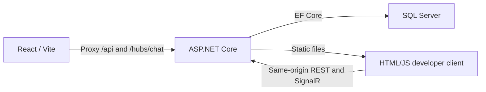

# Sandesh

Sandesh uses a React application, an ASP.NET Core .NET 10 backend, SignalR, and SQL Server through EF Core. Both frontends connect to the same backend.

## Architecture

| Location                           | Responsibility                                                         |
| ---------------------------------- | ---------------------------------------------------------------------- |
| `Two-Way-Com.csproj`, `Program.cs` | Single backend project and application startup at the repository root  |
| `src/Chat.Api/`                    | REST controllers, SignalR hub, and session filter                      |
| `src/Chat.Application/`            | Services, interfaces, and DTOs                                         |
| `src/Chat.Domain/`                 | Entities                                                               |
| `src/Chat.Infrastructure/`         | DbContext, migrations, and presence tracker                            |
| `frontend/`                        | Primary React application                                              |
| `wwwroot/`                         | HTML/CSS/JavaScript developer utility for API, JWT, and SignalR checks |
| `docs/`                            | Contracts and observed test results                                    |
| `Two-Way-Com.http`                 | Read-only authenticated API request example                            |

The `Chat.*` folders organize one assembly. React runs separately during development. ASP.NET Core serves the developer client through its default static-file configuration. This checkout has no tracked development script suite; future shared scripts can live in `scripts/`.



## Prerequisites

Install .NET 10 SDK, SQL Server or Windows SQL Server LocalDB, and Node.js 22.13+ on the 22.x line or Node.js 24 with npm. These Node versions satisfy the locked Vite and ESLint requirements.

Use `dotnet-ef` 10.0.14 to match the EF Core packages. Check with `dotnet ef --version`. If absent, run `dotnet tool install --global dotnet-ef --version 10.0.14`. If a different global version is installed, use `dotnet tool update --global dotnet-ef --version 10.0.14`.

## Configure the backend

Run setup commands from the repository root. The project already has a `UserSecretsId`, so User Secrets initialization is complete. For a project without that ID, the initialization command is `dotnet user-secrets init --project Two-Way-Com.csproj`.

Set local values using User Secrets. Replace the key placeholders with independent random secrets before executing these examples. The connection example uses Windows LocalDB and an isolated local development database. For another SQL Server instance, supply its actual server and authentication settings.

```powershell
dotnet user-secrets set 'ConnectionStrings:DefaultConnection' 'Server=(localdb)\MSSQLLocalDB;Database=SandeshLocalDev;Integrated Security=True;TrustServerCertificate=True' --project Two-Way-Com.csproj
dotnet user-secrets set 'Jwt:Key' '<random secret of at least 32 UTF-8 bytes>' --project Two-Way-Com.csproj
dotnet user-secrets set 'Jwt:Issuer' 'Sandesh.Local' --project Two-Way-Com.csproj
dotnet user-secrets set 'Jwt:Audience' 'Sandesh.Local.Client' --project Two-Way-Com.csproj
dotnet user-secrets set 'Otp:HashingKey' '<independent random secret of at least 32 characters>' --project Two-Way-Com.csproj
```

The backend validates a JWT key of at least 32 UTF-8 bytes, nonblank issuer and audience, and an OTP hashing key of at least 32 characters. Optional `Jwt:ExpiryInDays` defaults to 45 and must be a positive integer. Keep keys stable across restarts when testing existing JWTs and OTPs.

Development loads project User Secrets, which stores values outside the repository in plaintext. Environment variables override JSON and User Secrets. Use `__` for nested environment keys, such as `ConnectionStrings__DefaultConnection`. Keep secrets, OTPs, JWTs, and connection credentials out of Git. The root `appsettings.json` is ignored and machine-local when present.

## Prepare and start locally

Confirm the configured SQL Server instance is available and the database target is your intended disposable development database. The migration command changes its schema and may create the database when permissions allow. Coordinate upgrades of existing data with its owner.

```powershell
dotnet restore Two-Way-Com.csproj
dotnet build Two-Way-Com.csproj
$env:ASPNETCORE_ENVIRONMENT = 'Development'
$env:DOTNET_ENVIRONMENT = 'Development'
dotnet ef database update --project Two-Way-Com.csproj --startup-project Two-Way-Com.csproj --context ChatDbContext
dotnet run --project Two-Way-Com.csproj --launch-profile http
```

Explicit Development settings also load User Secrets for EF design-time startup. EF uses the application's startup configuration, including JWT requirements. The `http` profile starts Development on port 5261. The `https` profile uses ports 7005 and 5261. Stop an existing instance in its terminal before starting another on the same port.

In a second terminal, from the repository root, start React.

```powershell
cd frontend
npm.cmd ci
npm.cmd run dev
```

Open http://localhost:5173 for the primary app. Use `npm` in place of `npm.cmd` on macOS/Linux. Run React npm commands inside `frontend`; the root npm manifest supports the older developer utility. Vite uses strict port 5173 and fails when occupied. It proxies `/api` and `/hubs/chat`, including WebSockets, to http://localhost:5261. Set `VITE_API_BASE_URL` in the frontend terminal before startup to use another backend URL.

Open http://localhost:5261/index.html for the developer client or http://localhost:5261/swagger for Development API exploration. Both clients use the backend's authentication rules. React handles the session-takeover UI.

## Development OTP

Development uses the console SMS sender. Retrieve the code from the backend terminal and verify it in React. Fresh mobiles continue to profile completion. Accounts with an active session require confirmation before takeover. Use different accounts in separate browser profiles for two-user chat checks.

The optional React OTP preview defaults to disabled. Set `$env:Otp__ExposeForLocalTesting = 'true'` in the backend terminal before startup to enable it. It requires Development and the development sender. Successful Send OTP responses then add `developmentOtp` after save, commit, and delivery. Set the flag to `'false'` and restart to disable it.

Production and Staging currently use an unconfigured sender and return HTTP 503 on delivery attempts until a real provider is integrated.

With Development selected and no higher-priority overrides, `appsettings.Development.json` supplies these values. The fallback column applies when the corresponding configuration key is absent.

| Setting | Development JSON | Code fallback |
|---|---|---|
| Mobile send limit | 30 per rolling 15 minutes | 3 per rolling 15 minutes |
| IP send limit | 100 per fixed 15-minute window | 3 per fixed 15-minute window |
| Backend resend cooldown | 5 seconds | 60 seconds |
| OTP expiry | 5 minutes from creation | 5 minutes from creation |

The service counts persisted OTP records for the normalized mobile and checks cooldown under its SQL lock. IP limiting runs in middleware per remote IP and application instance. User Secrets, environment variables, or command-line settings can override the JSON values. React's resend UI currently waits 60 seconds independently of the backend cooldown.

## Checks and hosting

Run `dotnet build Two-Way-Com.csproj` from the root. From `frontend`, run `npm.cmd run lint` and `npm.cmd run build`. Also verify sign-in and a live message exchanged between two test accounts in browsers.

React builds into `frontend/dist`. Production hosting needs API routing and SignalR WebSocket support. Vite's development proxy applies to the dev server. The backend currently serves the HTML/JS utility in every environment. Deployment topology and access to that utility need a team decision.

## Documentation and verification scope

- [React development](frontend/README.md)
- [Authentication contract, migrations, and observed results](docs/otp-only-auth.md)
- [Send OTP manual test notes](docs/send-otp-testing.md)
- [Authenticated HTTP request example](Two-Way-Com.http)

Full V1 acceptance, real SMS, physical devices, and multiple backend instances remain pending. The natural OTP-expiry message was observed; its exact HTTP status is pending confirmation. The linked documents retain historical manual and automated observations.

## Team Members

- Member 1: Gourav Khore
- Member 2: Jay Kumrawat
- Member 3: Ramnaryan Ingla
- Member 4: Mayank Parmar
